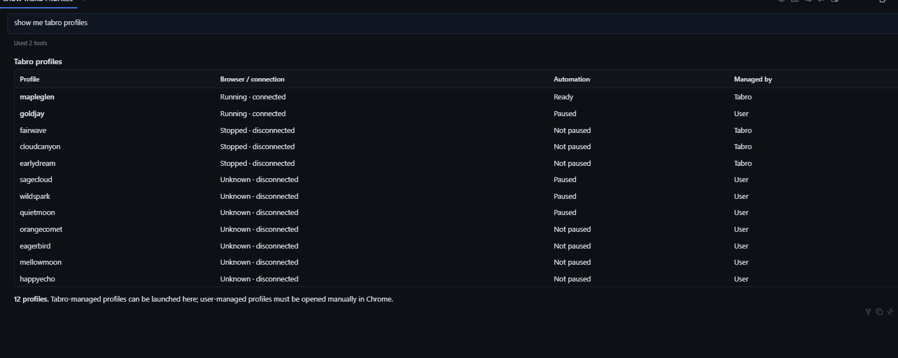
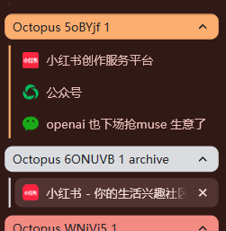
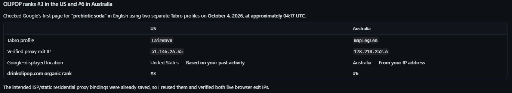
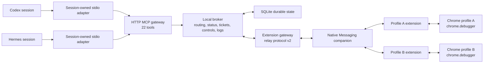

# Tabro

> **Current installation:** Follow [Getting Started](./GETTING_STARTED.md) for machine registration and the supported package setup. Source tools reuse the registered installation.

[English](./README.md) | [简体中文](./README.zh-CN.md) | [中文文档](./doc/zh-CN/README.md)

Open-source Chromium browser automation for AI agents: one shared Broker, separate task workspaces, and per-profile proxies through MCP.

**[Get started →](./GETTING_STARTED.md)** Set up Hermes, Codex or another MCP agent, then connect a new managed browser or an existing Chrome, Edge or AdsPower SunBrowser profile.

> [!TIP]
> **Copy this prompt to your agent**
>
> Follow the [Getting Started guide](./GETTING_STARTED.md) in `ohmyskyhigh/tabro`. Download the available installer for my OS and CPU and verify its SHA-256. Run setup on the desktop host under the same OS account as Chrome, outside the agent sandbox. Keep Chrome’s own security sandbox enabled.
>
> Register the local stdio MCP server and help me load the unpacked extension into my chosen Chrome profile. Confirm that the profile appears in MCP, then use a Tabro workspace to read the title of `https://example.com`. If you lack host or browser access, give me the steps to run on that host.

Tabro was previously named Octopus Browser Relay. New MCP registrations use `tabro`. Existing installations and data require inspection before migration to the device-wide Broker. The repository is now [ohmyskyhigh/tabro](https://github.com/ohmyskyhigh/tabro); historical release asset filenames remain valid.

Tabro connects a local MCP gateway to one extension instance in each browser profile. An agent asks for browser capacity, receives broker-issued workspace and tab references, submits extension-supported Chrome DevTools Protocol (CDP) commands, and polls durable request tickets. The extension relays those commands through `chrome.debugger`; Chrome does not need a public remote-debugging port.

> [!IMPORTANT]
> The `0.5.0` source tree implements the twenty-two-tool runtime, authenticated HTTP(S)/SOCKS5 profile proxies, relay-v2, Native Messaging and extension-backed CDP. The published [0.4.2 Windows preview](https://github.com/ohmyskyhigh/tabro/releases/tag/hermes-v0.4.2) remains available while the new installers are qualified and [Hermes relisting](https://github.com/ohmyskyhigh/tabro/issues/2) is pending. The `v0.3.0` standalone release uses the previous Octopus name and fourteen-tool contract. See [Getting Started](./GETTING_STARTED.md) for setup and the [real-world runbook](./doc/06-Files/Real-World-Runbook.md) for platform qualification.

## Features

Screenshots from the [Tabro 0.4.0 preview](https://github.com/ohmyskyhigh/tabro/releases/tag/hermes-v0.4.0) show three core features.

### Multiple agents share one Broker

Multiple agents connect to the same local Broker and discover the same browser profiles. They can share a logged-in browser and account, or work across different profiles.



### Each agent creates separate workspaces for different tasks

Each agent can create dedicated tab-group workspaces for different tasks. The Broker tracks ownership and keeps browser commands scoped to the correct workspace, so agents can share an account without taking over each other's tabs.



### Each Broker-managed profile can use its own authenticated proxy

Configure HTTP, HTTPS, or SOCKS5 proxies with username/password authentication through MCP. With saved credentials, an agent can configure each profile while closed, open the browsers, verify their exit IPs, and compare results across regions from a single request.



## Quick start

Start with [Getting started](./GETTING_STARTED.md) for standalone installers, local MCP registration and Chrome pairing. The release workflow stages Windows x64, macOS arm64 and x64, and Linux x64 packages and requires a real Chrome check for each. The Windows Hermes catalog and source-build paths remain available separately.

The current Windows source updater requires a release declaring shared runtime discovery support. The published `v0.3.0` installer retains its older contract. The getting-started guide also covers the separate Windows 0.4.2 preview package.

### The source installer prepares the current twenty-two-tool shared runtime

1. Build with `pnpm install --frozen-lockfile` and `pnpm build`, then run `pnpm stage:hermes --output=tabro-v0.5.0-<platform>` for the current platform.
2. Follow [Getting Started](./GETTING_STARTED.md#standalone-installers) to provision one device owner and run the staged package's setup as that user.
3. Register the printed stdio MCP entry, load the printed extension directory for an existing profile, and verify a real browser action.

## What agents can do

- discover connected browser-profile endpoints and broker-issued window choices;
- list all extension-registered Profiles with broker/user ownership, create broker-owned ones, and reopen or stop them;
- configure authenticated HTTP(S)/SOCKS5 proxies on closed broker-owned Profiles, then reopen and verify their exit IP;
- request one or more workspaces on distinct profiles;
- receive an initial managed tab and CDP event cursor for each workspace;
- create additional managed tabs;
- send raw CDP commands from the extension-supported capability manifest;
- poll asynchronous request tickets and read retained CDP events;
- transfer, pause, resume, terminate, or recover workspace control; and
- pause or resume every owned workspace on one endpoint.

The broker keeps the relationship among agent sessions, endpoints, windows, workspaces, tabs, tickets, and live extension connections. Agent-facing calls use broker-issued references and endpoint nicknames instead of Chrome profile IDs, extension IDs, window IDs, tab IDs, socket IDs, or debug ports.

## Architecture



Normal installed profiles use the Native Messaging companion. The companion forwards extension messages to the broker's loopback relay. Direct extension-to-WebSocket transport remains available only for diagnostics.

Read the canonical [Product definition](./doc/01-Product/Product-Definition.md), [MCP contract](./doc/03-User-Interface/MCP-Contract.md), [System architecture](./doc/04-System/System-Architecture.md), and [Component architecture](./doc/05-Components/Component-Architecture.md) for the complete design.

## Requirements

Use [Getting Started](./GETTING_STARTED.md#standalone-installers) for the standalone packages. The Windows source installation below uses these requirements.

- Windows with PowerShell, current-user Native Messaging registry access, and WinHTTP WebSocket support;
- Node.js `22.12.0` or newer;
- pnpm `11.19.0` or another compatible pnpm 11 release;
- A compatible Chrome, Chromium or Microsoft Edge browser; managed profiles and the Hermes plugin require version `153` or newer; and
- Visual Studio C++ Build Tools with an x64 compiler and Windows SDK when rebuilding the native companion.

## Installation

### The installer builds, registers, and prepares the local runtime

Build the runtime with `pnpm build`, stage a package with `pnpm stage:hermes --output=tabro-v0.5.0-<platform>`, then provision and run it using [Getting Started](./GETTING_STARTED.md#standalone-installers). On Windows, `pwsh -NoProfile -File tools/install-local.ps1 -PackagePath <extracted-current-package>` delegates to that package's setup. The package prints the MCP and extension paths.

### Preflight reports each missing setup action as JSON

Use the installed package's health and browser verification steps in [Getting Started](./GETTING_STARTED.md#verification). The older source preflight expects generated legacy handoff files and does not qualify the device-wide runtime.

### GitHub Releases provide verified installation and updates

Use the checksum-verified current standalone package as described in [Getting Started](./GETTING_STARTED.md#standalone-installers). On Windows, `pwsh -NoProfile -File tools/update-local.ps1 -PackagePath <extracted-current-package>` delegates to its fenced setup. Finish active browser work before updating and reload the browser extension after its files change.

### The stop command refuses to terminate an unrelated process

Use the current package's `stop.ps1` on Windows or `node <install-root>/tabro.mjs stop` on macOS and Linux. The broker fences admission and refuses to stop while work is active. The Windows source wrapper `tools/stop-local-broker.ps1` delegates to the registered installation.

### Development mode runs the broker directly from TypeScript

A source broker can start only when the machine registration explicitly designates that source root and its data directory. When a package is registered, use its launcher; another checkout cannot start a competing Broker. Build source with `pnpm build` and follow [Getting Started](./GETTING_STARTED.md) for the registered installation.

## Browser profile pairing

### Every browser profile loads and pairs its own extension instance automatically

Repeat these steps inside each Chrome profile that the broker should control:

1. Open `chrome://extensions`.
2. Enable **Developer mode**.
3. Choose **Load unpacked** and select `dist/browser-extension`.
4. Confirm the extension ID is `caekiojlchhifdomfghejkbfpmaklafe`.
5. Open **Tabro Settings**. The extension displays an editable two-word profile-local pairing code and its compact combined nickname, such as `MINT-WAVE` and `mintwave`.
6. Keep the generated code or enter two three-to-eight-letter words, keep **Native companion** selected, and choose **Save settings and reconnect** after any change.
7. Wait until the extension reports `Status: connected` with the final endpoint nickname.

The extension generates the default readable code and registers itself with the running loopback broker; there is no broker-issued code command or copy step. The saved generated or customized code remains authoritative across browser windows and restarts. An existing endpoint is renamed only after reconnect authentication proves the profile's persisted cryptographic identity. A nickname collision preserves the requested code and shows an error until you choose another. The readable code helps correlate this profile with its endpoint and is not an authorization secret. Repeat the load-and-connect steps in every participating profile.

### Direct WebSocket stays available for explicit diagnostics

The extension options page can connect directly to the `relayUrl` published in the runtime record, but that mode is not the normal Chrome setup. Browser kernels can block extension-initiated loopback WebSockets even when ordinary page requests to `127.0.0.1` work. Use **Native companion** for installed profiles and switch to direct WebSocket only while diagnosing transport behavior.

## Agent registration

### The installer generates a Codex stdio MCP configuration fragment

Use the command and arguments printed by the registered package setup, as described in [Getting Started](./GETTING_STARTED.md#codex-connects-through-its-stdio-mcp-registration). Start a new Codex session after registration.

### The installer generates one Hermes command for every installed profile

Enable the compatible Hermes plugin for each profile and reload its MCP connection. See [Getting Started](./GETTING_STARTED.md#hermes) for the supported package and profile setup.

### One stdio adapter process supplies caller evidence for one agent session

The adapter prefers runtime-owned environment values in this order:

- `CODEX_THREAD_ID`;
- `CODEX_SESSION_ID`;
- `HERMES_SESSION_ID`; and
- `HERMES_AGENT_SESSION_ID`.

`TABRO_RUNTIME_SESSION` can supply an explicit fallback. When none exists, the adapter generates one random session key at startup and retains it for that process. Parent-session variants are forwarded for related subagents.

The adapter forwards these facts to the HTTP broker as `x-octopus-runtime`, `x-octopus-runtime-session`, and optional `x-octopus-parent-runtime-session` headers. They are adapter-supplied evidence, not values for the model to invent or include in tool bodies.

## MCP tools

### Twenty-two tools cover profiles, proxies, browser work, monitoring and control

| Execution | Tool | Purpose |
| --- | --- | --- |
| Read | `list_browser_profiles` | List registered broker-owned and user-owned Profiles, including offline identities and observed readiness. |
| Async | `create_browser_profile` | Create a broker-owned persistent Profile, launch the configured browser, and connect its extension. |
| Async | `open_browser_profile` | Open a broker-owned Profile or reuse its running instance. |
| Async | `stop_browser_profile` | Normally close a broker-owned Profile after its active work ends. |
| Read | `get_browser_proxy` | Read saved routing, application status and the last exit-IP observation for a broker-owned Profile. |
| Async | `set_browser_proxy` | Save proxy routing for a closed broker-owned Profile, to apply on its next explicit open. |
| Async | `clear_browser_proxy` | Clear Tabro proxy routing for a closed broker-owned Profile. |
| Async | `check_browser_proxy` | Check routing and observe the exit IP of a connected broker-owned Profile. |
| Read | `get_browser_context` | Read one narrow, paginated broker, endpoint, window, capability, workspace, tab, or request-summary view. |
| Async | `request_browser_workspace` | Request an exact number of workspaces on distinct eligible profile endpoints. |
| Async | `create_browser_tab` | Create one managed tab in an owned workspace. |
| Async | `send_cdp_command` | Submit one supported raw CDP command to one managed tab. |
| Read | `read_cdp_events` | Read retained CDP events from a broker-issued tab cursor. |
| Read | `get_browser_request` | Read one visible request ticket. |
| Async | `take_over_workspace` | Transfer one exactly identified workspace. |
| Async | `terminate_workspace` | Reconcile running work, archive the tab group, and end the workspace. |
| Async | `resolve_browser_request` | Resolve one owner-visible request paused for confirmation. |
| Immediate | `close_browser_request` | Remove one terminal ticket from public discovery while retaining audit history. |
| Async | `stop_workspace_automation` | Pause one workspace manually. |
| Async | `resume_workspace_automation` | Reconcile and clear the workspace's manual-stop cause. |
| Async | `kill_browser_endpoint` | Pause every active workspace on one entirely owned endpoint. |
| Async | `resume_browser_endpoint` | Reconcile the endpoint and clear its endpoint-kill cause. |

Every asynchronous tool returns an accepted `request_ref` before its browser effect becomes eligible for dispatch. The agent polls that reference with `get_browser_request`. The exact request and result schemas live in [MCP-Contract.schema.json](./doc/03-User-Interface/MCP-Contract.schema.json).

The current extension capability baseline is [extension-baseline.json](./apps/shared/protocol/capabilities/extension-baseline.json). It includes selected Accessibility, DOM, Emulation, Input, Network, Page, and Runtime methods, all confined to a managed tab.

### Agents can select local images and other files with DOM.setFileInputFiles

Use `DOM.getDocument` and `DOM.querySelector` to locate an `input[type="file"]` in the managed tab, then call `send_cdp_command` with its node ID:

```json
{
  "workspace_ref": "<workspace_ref>",
  "target": { "kind": "tab", "tab_ref": "<tab_ref>" },
  "method": "DOM.setFileInputFiles",
  "params": { "nodeId": 42, "files": ["C:\\uploads\\image.png"] }
}
```

Poll the returned `request_ref` with `get_browser_request` until completion. Supply absolute paths accessible on the **browser's machine**; Tabro forwards paths and does not transfer file bytes from a remote agent. The command also accepts `backendNodeId` or `objectId` instead of `nodeId`, multiple paths for a multiple-file input, and `files: []` to clear the selection. Setting the input selects files; complete any page-specific upload or submit step afterward. See the [CDP method definition](https://chromedevtools.github.io/devtools-protocol/tot/DOM/#method-setFileInputFiles).

## Local endpoints and state

The registered installation keeps discovery in `<install-root>/data/runtime.json`, the database in `data/relay.sqlite`, and its private authentication material in `data/`. MCP and relay use dynamically assigned loopback ports. The broker, clients and native companion discover the same registered installation; path overrides cannot select another broker.

## Verification

### Automated checks exercise contracts, storage, gateways, broker policy, and packaging

```powershell
pnpm lint
pnpm typecheck
pnpm test
pnpm test:e2e
pnpm build
```

`pnpm verify` runs those checks as one gate. On Windows, `pnpm build` uses the C++ toolchain for the Native Messaging companion. On macOS, it uses Clang for the process and Keychain helper. The [release workflow](./.github/workflows/release.yml) packages the runtime and qualifies each installer against Chrome.

## Troubleshooting

### A disconnected extension is diagnosed from the native host toward the broker

1. Read `relayUrl` from the runtime record, change `ws:` to `http:` and `/relay` to `/health`, and confirm it responds.
2. Confirm the extension ID is `caekiojlchhifdomfghejkbfpmaklafe` and **Native companion** is selected.
3. Confirm the extension directory still exists at the path reported by the updater.
4. Check the package setup output and the native registration for your browser.
5. Reload the unpacked extension after updating its files. If it reports a required-version mismatch, update and restart the broker to remove the old version gate, then reconnect the extension.

For a source checkout, run `pwsh -NoProfile -File .\tools\real-world-preflight.ps1`. For a GitHub Release install, check both health endpoints and the generated handoff files directly.

### An agent that cannot see twenty-two tools needs a fresh stdio adapter process

Confirm the broker health first. Then verify that the Codex or Hermes registration points to the generated stable adapter launcher and token-file path. Rerun `hermes-mcp.txt` if the affected Hermes profile is missing its entry, and restart the agent session after changing its MCP registration. Hermes can check that profile with:

```powershell
hermes -p <profile> mcp test tabro
```

Exactly twenty-two tools must be discovered. Do not point an agent at the relay WebSocket port; agents use the stdio adapter and HTTP MCP gateway.

### Dynamic port allocation avoids conflicts without stopping unrelated applications

The registered Broker uses dynamically assigned loopback ports and publishes them in `<install-root>/data/runtime.json`. Source start and stop wrappers reuse the registered Broker; they do not create a separate data store.

## Current limits

- The legacy updater and checked-in Hermes catalog package target Windows x64. The [qualification record](./doc/06-Files/Real-World-Runbook.md#packaged-installation) tracks standalone evidence by OS and architecture.
- macOS and Linux setup accepts `--browser-data-dir` for a custom browser user-data directory.
- Standalone packages print a local stdio MCP handoff for the operator to register.
- Independent sessions remain distinct when the host launches one adapter process per session or supplies a supported runtime session environment value. A host that deliberately reuses one adapter process across unidentified sessions also reuses that adapter identity.
- The HTTP broker confirms an accepted ticket after handing it to the stdio adapter. MCP has no transaction spanning that HTTP handoff and the adapter's later stdout write, so an adapter crash in that narrow interval can dispatch work whose ticket the agent runtime did not receive.
- The extension executes only methods published by `octopus-extension-baseline-v1`; flattened child CDP sessions are disabled.
- Relay-v2 extension envelopes are limited to 1 MiB. Capability and inventory limits are published in the same manifest.
- The relay-v1 compatibility bridge remains enabled for migration, while the public MCP gateway exposes only the canonical twenty-two tools.
- The repository does not install Codex, Hermes, or Chrome. The current release has recorded a three-profile, independent-Codex-session, and Hermes physical qualification; another machine or browser build still requires its own preflight and physical evidence.
- There is a PID-verified broker stop command but no full uninstall command yet.

## Repository layout

```text
doc/                    Top-down knowledge vault and change governance
apps/broker/            Broker runtime, core, MCP, relay, and storage source
apps/browser-extension/ Manifest V3 extension source
apps/mcp-stdio-adapter/ Session-owned stdio bridge for Codex and Hermes
apps/native-host/       Platform Native Messaging companions and macOS helper
apps/shared/protocol/   MCP schemas, relay schemas, domain facts, and capabilities
tools/                  Build, install, pairing, preflight, and test automation
tests/                  Contract, unit, integration, fault, E2E, and physical tests
dist/                   Generated broker, adapter, extension, and native artifacts
```

Start with the [top-down vault map](./doc/TOP-DOWN-MOC.md) for project knowledge and the [repository map](./doc/06-Files/Repository-Map.md) for exact implementation paths.

## Contributing

Read [CONTRIBUTING.md](./CONTRIBUTING.md), the vault [editing rules](./doc/AGENTS.md), and [SECURITY.md](./SECURITY.md) before changing contracts, routing, transport, listener scope, or identity behavior. Do not include bearer tokens, pairing codes, private browser identifiers, profile paths, or SQLite files in public reports.

## License

Tabro is available under the [MIT License](./LICENSE).

## Managed Profiles

### Agents can create and reopen persistent Chromium browser Profiles through MCP

The development implementation includes list_browser_profiles, create_browser_profile, open_browser_profile and stop_browser_profile under MCP contract v5. The pairing alias (`endpoint_nickname`) is each Profile's only public name; creation requires only an idempotency key. Managed launch supports compatible Chrome, Chromium and Edge 153+ on Windows with one-time Native Messaging installation. The exact Chrome build lock has been replaced by version and runtime capability checks. New Profiles automatically load the extension; normal stop retains cookies, website storage and identity. The Hermes package includes this implementation; see its installation guide for the selected-browser prerequisite.

Use the registered package setup in [Getting Started](./GETTING_STARTED.md). Compatible clients share its Broker. Read the [single-Agent Demo runbook](./tests/demo/RUNBOOK.md) for the two verified three-Profile runs and reproduction steps.

## Domain rules

### Selected domains can require input actions while preserving observation

The contract-6 source implementation supports a persistent `data/browser-rules.json` list shared by Codex and Hermes. Add a domain to require mouse/keyboard input for manipulation while permitting guarded JavaScript, DOM, accessibility and screenshots for observation. Domains include nested subdomains and all paths. See [rule configuration](./GETTING_STARTED.md#domain-rules) for the format, validation and recovery behavior. Native release qualification is tracked in the [implementation plan](./doc/80-Plans/domain-input-only-rules-2026-11-10/README.md); this source update does not publish a new package.

## Extension dashboard

### Open the extension to see connection details, profiles and website rules

Click the **Tabro toolbar icon** or open its **Extension options**. The **Connection** tab shows the pairing code, profile alias and live connection status, with reconnect and pairing settings. **Broker management** lists profiles and their status, and lets you add, edit or remove input-only domain rules. Profile management is read-only in this version. Rules use the same persistent file across Codex and Hermes; conflicting edits require a refresh before saving. See [dashboard setup](./GETTING_STARTED.md#extension-dashboard). The dashboard is included in source builds; upgrade the Broker and extension together when a matching package is released.

Profile rows show **Connection** and **Automation** separately: connected automation can be paused, and connection failures show their error. New tabs open in the background by default. Agents may explicitly bring a tab forward when a website needs it to start or receive input; background operation is a soft preference, while input-only rules still apply.
