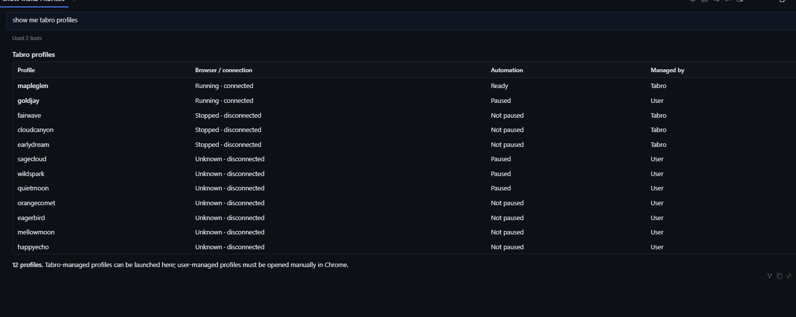
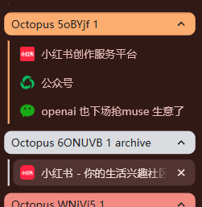
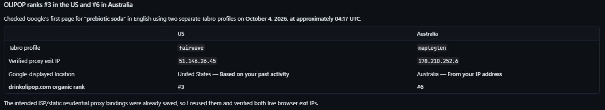
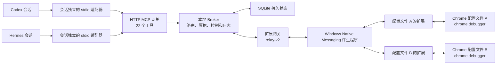

# Tabro

> **当前安装方式：**请按 [入门指南](./GETTING_STARTED.md) 完成设备注册并使用当前安装包。源码工具复用已注册的安装。

项目原名为 Octopus Browser Relay。新的 MCP 注册名为 `tabro`；迁移到设备级 Broker 前应检查已有安装和数据。GitHub 仓库已迁移至 [ohmyskyhigh/tabro](https://github.com/ohmyskyhigh/tabro)，历史发布附件保留原文件名。

[English](./README.md) | [简体中文](./README.zh-CN.md) | [中文文档](./doc/zh-CN/README.md)

Tabro 是面向 AI Agent 的开源 Chromium 浏览器自动化工具：通过 MCP，共用一个 Broker、为不同任务创建独立工作区，并为每个浏览器 Profile 配置代理。

**[开始使用（英文）→](./GETTING_STARTED.md)** 配置 Hermes、Codex 或其他 MCP Agent，然后通过 MCP 创建浏览器，或在已有 Chrome、Edge、AdsPower SunBrowser Profile 中加载扩展。

每个浏览器配置文件安装一个扩展实例。Agent 向本地 Broker 申请工作区，获得 Broker 签发的 `workspace_ref`、`tab_ref` 和请求票据，再通过扩展支持的 Chrome DevTools Protocol（CDP）子集执行浏览器操作。扩展使用 `chrome.debugger`，无需公开暴露 Chrome 远程调试端口；受管启动内部使用 loopback 管理连接。

> [!IMPORTANT]
> `0.5.0` 源码实现 22 个 MCP 工具、HTTP(S)/SOCKS5 账号密码代理、relay-v2、Native Messaging、扩展 CDP 适配器及受管 Profile 生命周期。新版安装包验收和 [Hermes 重新收录](https://github.com/ohmyskyhigh/tabro/issues/2)期间，仍可使用已发布的 [0.4.2 Windows 预览包](https://github.com/ohmyskyhigh/tabro/releases/tag/hermes-v0.4.2)。`v0.3.0` 独立发布使用旧 Octopus 名称和 14 工具协议。安装请看[开始使用](./GETTING_STARTED.md)，各平台验收结果见[验收手册](./doc/06-Files/Real-World-Runbook.md)。

## 功能展示

以下 [Tabro 0.4.0 预览版](https://github.com/ohmyskyhigh/tabro/releases/tag/hermes-v0.4.0)截图展示三个核心功能。

### 多个 Agent 共用一个 Broker

多个 Agent 连接同一个本地 Broker，发现同一组浏览器 Profile。它们既可以共用已登录的浏览器和账号，也可以在不同 Profile 中工作。



### 每个 Agent 为不同任务创建独立工作区

Agent 可以为不同任务创建独立的标签组工作区。Broker 记录工作区归属，并将浏览器命令限定在对应工作区内，让多个 Agent 共用账号时不会接管彼此的标签页。



### 每个 Broker 托管 Profile 可以使用独立的账号密码代理

通过 MCP 配置支持账号密码认证的 HTTP、HTTPS 或 SOCKS5 代理。保存凭据后，Agent 可以在 Profile 关闭时配置代理，再打开浏览器、验证出口 IP，并通过一句指令完成不同地区的搜索结果对比。



## 快速开始

请先阅读[开始使用（英文）](./GETTING_STARTED.md)，按系统选择独立安装包，然后注册本地 MCP 并连接 Chrome。发布流程对 Windows x64、macOS arm64 和 x64、Linux x64 分别运行真实浏览器验收。下方为 Windows 源码安装路径。

### 开发者可从源码安装二十二工具的共享运行时

运行 `pnpm install --frozen-lockfile`、`pnpm build`，再用 `pnpm stage:hermes --output=tabro-v0.5.0-<平台>` 构建当前安装包。按[入门指南](./GETTING_STARTED.md#standalone-installers)注册设备和桌面用户、运行安装包，使用输出的 MCP 与扩展路径完成连接验证。

## 功能

### Agent 使用 Broker 签发的引用操作多个独立浏览器配置文件

- 发现已连接的浏览器端点和可选窗口；
- 在不同配置文件上申请一个或多个工作区；
- 为每个工作区获得初始托管标签页和 CDP 事件游标；
- 创建额外托管标签页；
- 发送扩展能力清单允许的原始 CDP 命令；
- 轮询异步请求票据并读取保留的 CDP 事件；
- 接管、暂停、恢复、终止或人工确认工作区任务；
- 暂停或恢复同一端点上由当前调用者完整拥有的所有工作区。

Agent 不接触 Chrome 配置文件 ID、扩展 ID、窗口 ID、标签页 ID、Socket ID 或调试端口。公开接口只接受端点昵称以及 Broker 签发的引用。

## 系统结构

### 本地 Broker 连接 Agent、持久状态、扩展网关和每个浏览器配置文件



已安装配置文件的正常连接方式是 Native Messaging。扩展直连 WebSocket 只用于诊断。中文架构与工具说明见[架构与 MCP](./doc/zh-CN/Architecture-and-MCP.md)。

## 环境要求

### 当前安装和 Native Messaging 流程以 Windows 为目标平台

- Windows、PowerShell 和当前用户注册表写入权限；
- Node.js `22.12.0` 或更高版本；
- GitHub Release 安装不要求 pnpm；从源码构建需要 pnpm `11.19.0` 或兼容的 pnpm 11；
- 兼容的 Chrome、Chromium 或 Microsoft Edge；受管 Profile 和 Hermes 插件要求版本 `153+`；
- 只有从源码重编译 Native Messaging 伴生程序时，才需要 Visual Studio C++ Build Tools、x64 编译器和 Windows SDK。

## Release 安装

### 独立更新器会校验、安装、注册并启动选定版本

按[入门指南](./GETTING_STARTED.md#standalone-installers)验证当前安装包的校验和，注册设备并以桌面用户运行安装。Windows 源码包装命令为 `pwsh -NoProfile -File tools/update-local.ps1 -PackagePath <解压后的当前安装包>`。

## 浏览器扩展

### 每个浏览器配置文件只需从稳定目录加载一次扩展

在每个需要控制的 Chrome 配置文件中：

1. 打开 `chrome://extensions`。
2. 开启**开发者模式**。
3. 点击**加载已解压的扩展程序**。
4. 选择安装器输出的 `extensionPath`。
5. 确认扩展 ID 为 `caekiojlchhifdomfghejkbfpmaklafe`。
6. 打开扩展设置页，保持 **Native companion**，等待连接成功。

每个配置文件拥有独立扩展存储、密钥、两词配对代码和简短昵称。配对代码可在扩展设置中编辑，保存后会跨浏览器窗口和重启保持不变；已有端点只有在密钥认证成功后才会改名。昵称冲突时，扩展会保留当前代码并显示错误，直到用户选择另一组词。两词代码用于人类识别配置文件，不是授权密钥。

### 后续更新复用同一路径，扩展重载后启用新代码

完成活动浏览器工作后运行新安装包的 setup。更新会阻止新请求并检查活动工作；更新文件后重载浏览器扩展。

## Agent 配置

### Codex 使用更新器生成的 TOML 片段启动会话独立适配器

按[入门指南](./GETTING_STARTED.md#codex-connects-through-its-stdio-mcp-registration)注册安装器输出的 stdio MCP 命令，然后新建 Codex 会话。

### Hermes 使用一个生成命令注册默认和所有已安装配置文件

按[入门指南](./GETTING_STARTED.md#hermes)为每个 Hermes 配置文件启用兼容插件并重载 MCP。

## 源码安装

### 开发者可以从仓库构建、注册并启动本地运行时

运行 `pnpm build` 并使用 `pnpm stage:hermes --output=tabro-v0.5.0-<平台>` 生成安装包。按[入门指南](./GETTING_STARTED.md)完成设备注册和安装。源码工具复用注册的 Broker；只有设备注册明确指向源码目录时才可直接启动源码 Broker。

## MCP 工具

### 22 个工具覆盖发现、浏览器工作、监控、恢复和控制

| 类型 | 工具 |
| --- | --- |
| 读取 | `list_browser_profiles` |
| 异步 | `create_browser_profile` |
| 异步 | `open_browser_profile` |
| 异步 | `stop_browser_profile` |
| 读取 | `get_browser_context` |
| 异步 | `request_browser_workspace` |
| 异步 | `create_browser_tab` |
| 异步 | `send_cdp_command` |
| 读取 | `read_cdp_events` |
| 读取 | `get_browser_request` |
| 异步 | `take_over_workspace` |
| 异步 | `terminate_workspace` |
| 异步 | `resolve_browser_request` |
| 立即 | `close_browser_request` |
| 异步 | `stop_workspace_automation` |
| 异步 | `resume_workspace_automation` |
| 异步 | `kill_browser_endpoint` |
| 异步 | `resume_browser_endpoint` |

所有异步工具都会先返回 Broker 签发的 `request_ref`，Agent 再用 `get_browser_request` 读取状态和结果。精确输入输出结构以英文规范 [MCP-Contract.schema.json](./doc/03-User-Interface/MCP-Contract.schema.json) 为准。

### Agent 可以通过 DOM.setFileInputFiles 选择本地图片和其他文件

先用 `DOM.getDocument` 和 `DOM.querySelector` 定位托管标签页中的 `input[type="file"]`，再调用 `send_cdp_command`：

```json
{
  "workspace_ref": "<workspace_ref>",
  "target": { "kind": "tab", "tab_ref": "<tab_ref>" },
  "method": "DOM.setFileInputFiles",
  "params": { "nodeId": 42, "files": ["C:\\uploads\\image.png"] }
}
```

使用返回的 `request_ref` 调用 `get_browser_request`，轮询至完成。路径必须是**浏览器所在机器**可访问的绝对路径；Tabro 转发路径，不会从远程 Agent 传输文件内容。也可以用 `backendNodeId` 或 `objectId` 替代 `nodeId`；多文件控件可传多个路径，`files: []` 可清空选择。设置文件控件后，按页面要求完成上传或提交操作。参数详见 [CDP 方法定义](https://chromedevtools.github.io/devtools-protocol/tot/DOM/#method-setFileInputFiles)。

## 验证

### 完整源码门禁覆盖静态检查、测试、E2E 和所有构建目标

```powershell
pnpm verify
```

也可以分别运行：

```powershell
pnpm lint
pnpm typecheck
pnpm test
pnpm test:e2e
pnpm build
```

健康接口从共享运行记录读取：

```text
<安装目录>/data/runtime.json → mcpUrl，将 /mcp 替换为 /health
<安装目录>/data/runtime.json → relayUrl，将 ws: 替换为 http:，/relay 替换为 /health
```

## 故障排查

### Demo 与日常 MCP 共享一个动态端口 Broker

Demo 和 MCP 共用注册的 Broker。动态地址保存在 `<安装目录>/data/runtime.json`，原生伴生程序和客户端使用同一设备注册。`tools/start-local-broker.ps1` 复用注册的 Windows Broker。

### 扩展未连接时应从 Broker 健康、Native Messaging 和扩展路径依次检查

1. 确认两个健康接口可访问。
2. 确认扩展 ID 和稳定扩展目录正确。
3. 确认扩展使用 **Native companion**。
4. 重新运行更新器以修复已安装文件和 Native Messaging 注册。
5. 更新扩展文件后重载扩展。如果仍提示版本号不匹配，更新并重启 Broker 以移除旧版本门禁，再重新连接扩展。

当前 `setup-readiness-checks.ts` 的交接文件检查仍要求配置中含固定 Broker URL，可能对有效的 `TABRO_RUNTIME_FILE` 注册报告 `mcp_registration_handoffs: ACTION_REQUIRED`。应核对发现文件、令牌路径并实测二十二工具；这项旧检查未通过仍须如实记录，不能靠反复重装消除。

### Agent 看不到 22 个工具时应重新创建适配器和 Agent 会话

确认 Codex 或 Hermes 配置指向生成的稳定适配器入口和令牌文件。修改 MCP 配置后必须新建会话。Agent 连接的是 stdio 适配器和 HTTP MCP 网关，浏览器 relay 的动态 WebSocket 地址不用于 Agent MCP 注册。

### 停止 Broker 时必须使用带 PID 和命令行校验的脚本

Windows 使用当前安装包的 `stop.ps1`；macOS 和 Linux 使用 `node <安装目录>/tabro.mjs stop`。Broker 先阻止新请求，仍有活动工作时拒绝停止。

## 当前限制

### 公开版本仍保留明确的开发边界

- Native Messaging 伴生程序和注册脚本目前仅支持 Windows。
- Release 安装不会安装 Codex、Hermes 或 Chrome。
- 扩展只执行 `octopus-extension-baseline-v1` 允许的方法。
- relay-v2 扩展消息上限为 1 MiB。
- relay-v1 兼容桥用于迁移，公开 MCP 契约 v5 提供 22 个工具。
- 当前有 PID 校验的停止命令，但还没有完整卸载命令。

## 仓库结构

### 应用、协议、工具、测试和知识库各自拥有独立目录

```text
apps/broker/            Broker、MCP、relay 和存储
apps/browser-extension/ Manifest V3 扩展
apps/mcp-stdio-adapter/ Codex/Hermes 会话独立适配器
apps/native-host/       Windows Native Messaging 伴生程序
apps/shared/protocol/   MCP、relay、领域事实和能力清单
doc/                    自上而下的项目知识库
tools/                  构建、安装、更新、预检和发布工具
tests/                  合同、单元、集成、故障、E2E 和真实测试
dist/                   生成的构建输出
```

## 文档权威

### 中文资料帮助安装和理解，但英文规范仍是唯一可编辑权威

中文入口见[中文文档](./doc/zh-CN/README.md)。产品、用户体验、MCP、系统、组件和文件结构的规范性定义以英文知识库 [TOP-DOWN-MOC.md](./doc/TOP-DOWN-MOC.md) 为准。若翻译与英文规范不一致，应以英文规范为准并修复翻译。

## 许可证

### 项目使用 MIT License

参见 [LICENSE](./LICENSE)。

## 受管 Profile

### Agent 可以通过 MCP 创建并重开自动连接的 Chromium 浏览器 Profile

本开发版本新增 list_browser_profiles、create_browser_profile、open_browser_profile、stop_browser_profile，使用 MCP contract v5。Windows 受管启动支持兼容的 Chrome、Chromium 和 Edge 153+，通过版本及运行能力检查，不再锁定一个 Chrome 构建号；Native Messaging 只需一次性安装，新 Profile 自动加载扩展。停止保留 Cookie、网站存储和扩展身份。Hermes 插件已包含此实现；安装前须按插件指南设置浏览器路径。

请使用[入门指南](./GETTING_STARTED.md)中的注册安装包；兼容客户端共用同一个 Broker。详细操作与两轮真实结果见 [单 Agent Demo 运行手册](./tests/demo/RUNBOOK.md)。

## 域名规则

### 指定域名可要求输入操作并保留页面观察能力

契约 6 的源码实现支持持久化 `data/browser-rules.json`，由 Codex 和 Hermes 共用。域名自动覆盖子域名和全部路径；页面操作使用鼠标和键盘输入，观察可使用受保护的 JavaScript、DOM、辅助功能树和截图。配置格式见 [设置说明](./GETTING_STARTED.md#domain-rules)，发布验收状态见 [实施计划](./doc/80-Plans/domain-input-only-rules-2026-11-10/README.md)。

## 扩展控制面板

### 从扩展查看连接信息、Profile 状态和网站规则

点击 **Tabro 工具栏图标**或打开**扩展选项**即可进入控制面板。**Connection** 显示配对码、Profile 别名和实时连接状态，可修改连接设置并重连。**Broker management** 只读展示 Profile 列表和状态，并支持新增、编辑、删除 input-only 域名规则。规则与 Codex、Hermes 共用同一持久化文件；发生编辑冲突时，须刷新后再保存。操作见[控制面板设置](./GETTING_STARTED.md#extension-dashboard)。此功能已加入源码构建；对应安装包发布后须一起升级 Broker 和扩展。

Profile 列表分别显示 **Connection** 和 **Automation**：连接正常时自动化仍可能暂停，连接失败会显示错误。新标签页默认在后台打开；网站需要前台才能启动或接收输入时，Agent 可显式激活标签页。后台运行是软性偏好，input-only 规则仍然生效。
